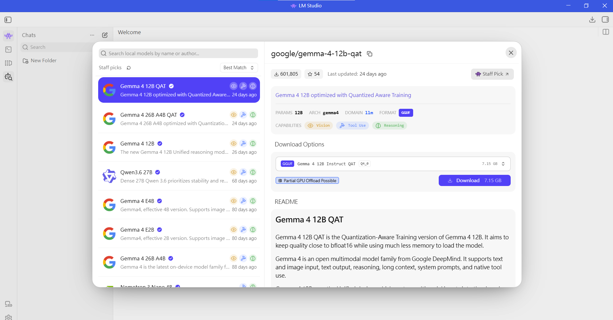
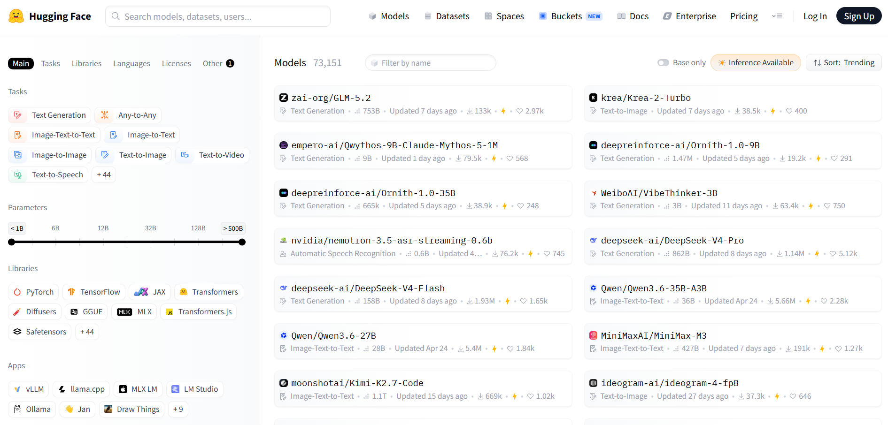
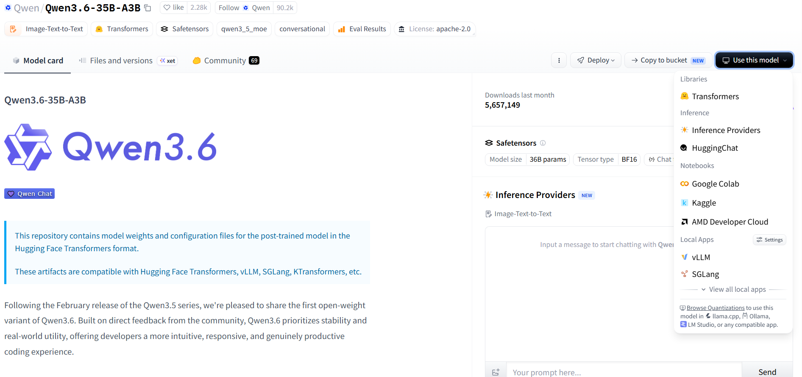
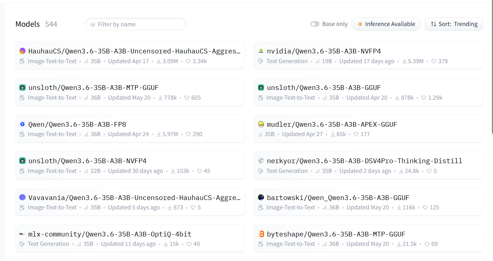
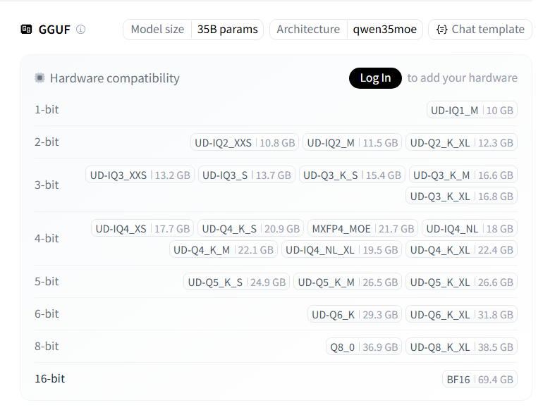

##  本地 AI 運作的核心觀念

[教學影片連結](https://www.youtube.com/watch?v=UngVdAsQEiU&t=30s)

- 硬體關鍵在於 VRAM：本地模型的運行非常依賴顯示卡的視訊記憶體（VRAM） (2:38)。如果模型大小能完全塞進 VRAM 中，執行速度會極快 (7:21)；一旦超出容量，多餘的資料會溢出到系統記憶體（RAM），導致生成速度大幅驟降（影片中實測速度差了約 6 倍） (3:47)。

- Mac 與 Windows 的差異：Windows 的 GPU VRAM 是獨立且有限的 (3:05)；而現代 Mac（Apple Silicon）採用統一記憶體（Unified Memory），由 CPU 與 GPU 共享，能以更低的成本獲得更大的記憶體空間來跑大型模型 (2:49)。

- 模型量化（Quantization）：為了在有限的硬體上執行大模型，會透過「量化」（如 Q4、Q6、Q8）將模型檔案壓縮變小（例如四捨五入浮點數），雖然會微幅犧牲品質，但能大幅降低所需的記憶體 (7:35)。

## 本地模型的選擇與軟體推薦

1. 推薦使用 [LM Studio](https://lmstudio.ai/)：

影片作者強烈推薦新手使用 LM Studio 作為管理與啟動本地模型的工具，因為它擁有直觀的介面，且能清晰顯示各模型預估消耗的記憶體 (5:30)。

2. 下載 ai model

進入 LM Studio 點選左欄搜尋 model 按鈕，選擇要下載的 model。
選擇 ai model 建議要有的能力
- 視覺辨識（Vision）：這是一款多模態模型，除了文字外，它能夠「看懂」並分析使用者上傳的圖片、圖表或照片。
- 工具調用（Tool Use）：它具備與外部工具或 API 對接的能力（例如執行網路搜尋、呼叫特定函式、或運行計算公式）。- 推理能力（Reasoning）：它擁有較強的邏輯思考與推導能力，適合用來處理複雜的程式碼除錯、數學運算或多步驟的邏輯問題。

3. 使用網站搜尋 ai model
可以到 [Hugging face](https://huggingface.co/) 找想用的 ai model

找 model 選擇 Inference Available，（意即「可進行推理」）指的是該模型可以直接在網頁上線上測試與執行。

這邊選擇 qwen3.6 模型，並點擊 browser quantization，可以選擇更小容量的版本。

這邊選擇 unsloth / Qwen3.6-35B-A3B-GGUF 

選擇適合電腦 gpu 容量的版本

