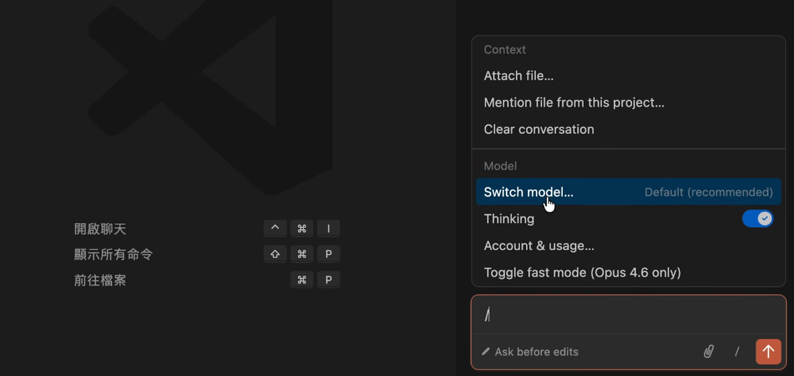
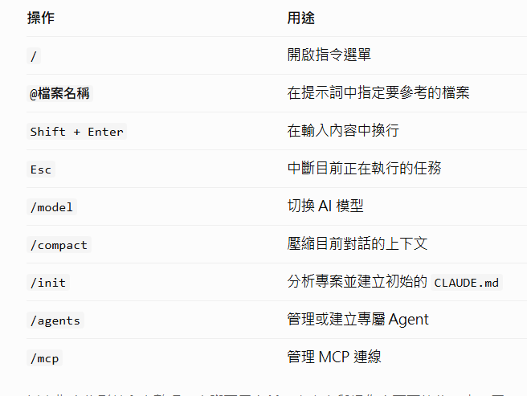

## 基本操作

1. 切換語言模型

2. 常用指令

## claude.md

在 Claude Code 中，CLAUDE.md 是一份專案說明與行為規範文件
用來告訴 Claude 這個專案的架構、開發規則，以及執行任務時需要注意的事項。

| 用途 | 說明 | 範例 |
|---|---|---|
| 專案背景 | 讓 Claude 了解專案目的與技術架構 | 使用 React、Vite、TypeScript |
| 程式碼規範 | 統一程式碼風格與撰寫方式 | 使用函式元件與 Hooks |
| 專案結構 | 說明重要資料夾與檔案的用途 | `src/components/` 存放共用元件 |
| 開發限制 | 告訴 Claude 哪些事情不要做 | 不要隨意新增套件 |
| 常用指令 | 提供開發、測試與建置指令 | `npm run dev`、`npm run build` |
| 工作流程 | 規範修改程式碼的步驟 | 修改後執行測試並檢查錯誤 |

## 還原

若想將claude改過的檔案還原到之前對話進度，可以按還原

## skills

